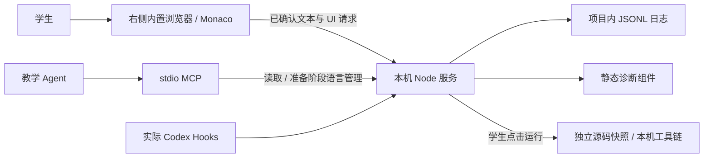

# XunJie-StudentIDE 架构

基线为 0.6.0。本次独立化沿用已有架构，没有迁移学生项目或日志格式，也没有改变整体教学平台的架构。

## 组件关系

浏览器只呈现编辑器和学生操作入口；共享服务持有已确认模型、版本、写入租约、日志、语言配置与运行状态。MCP 是薄桥接层，连接同一服务，避免另建一套代码或日志状态。Hooks 只记录宿主实际交付的事件。WebMCP 是可选的页面读取能力，不是主要连接方式。

## 编辑与日志

Monaco 产生初始快照与文本增量；浏览器保存待发送队列，服务验证项目路径、文档实例、版本链、范围和敏感内容。服务将完整事件批次写入 JSONL 并 `fsync` 后才确认；事件 ID 用于去重。浏览器草稿、服务已确认缓冲区与磁盘已保存文件是三个不同状态。

增量使用 JavaScript UTF-16 偏移，可包含多光标替换、撤销和重做。读取工具返回已确认版本与时间，回放从快照和增量重建。损坏日志和已知缺口保留，不用摘要修补原始事件。详见[数据与安全](DATA_AND_SECURITY.md)。

单项目允许一个活动写入窗口，租约约 30 秒。文件新建使用独占创建；回收文件前检查已确认版本与磁盘基线，保存文件、确认草稿和回收元数据，追加文件事件。原始历史保留。

## 阶段与工具

| 阶段 | Agent MCP 工具 | 学生与服务行为 |
| --- | --- | --- |
| `student` / 服务离线 | 四个读取工具 | 学生控制编辑、保存、运行、文件管理、界面、采集开关与阶段切换；离线读取报错，不启动服务 |
| `preparation` | 四个读取工具 + `open_student_ide`、`register_language`、`verify_language` | Agent 在授权范围内启动服务、安装所需工具链、注册与独立验证 |

阶段通过 `session.phase` 事件保存。首次启动默认 `student`；首次显式 `--phase preparation` 可初始化准备阶段。已有记录由学生 UI 切换，参数不会覆盖它。MCP 每秒更新工具列表，并在调用时再检查；HTTP 语言管理接口也检查阶段。UI 阶段切换带版本和租约，忙碌或冲突时拒绝。

`open_student_ide` 只返回已有准备服务的地址，不启动服务或实际打开页面。右侧显示由宿主的浏览器面板完成，插件不注册原生侧栏视图。

请求标记不是身份凭据。这些限制覆盖插件内工具与服务路由，尚未限制 Agent 的宿主 shell、文件系统或浏览器能力；开发者与接入 Agent 必须遵守[仓库规范](../AGENTS.md)，不能绕过学生边界。

## 语言与运行

项目级配置将工具链探测、编译、执行、采集范围和独立验证样例分开。配置更新产生新版本和定义哈希，使旧验证失效。学习阶段只能复用已验证且签名一致的工具链；变化或未验证时停止，并提示切回准备。

运行入口使用服务已确认的未保存内容；配置范围内其他源文件采用磁盘保存版本。每次运行建立独立源码快照与输出目录，编译失败不会执行。系统库与外部包未冻结，执行不是沙箱。详见[语言契约](LANGUAGE_CONTRACT.md)。

## 静态诊断

学生编辑确认后，UI 防抖约 500 ms 请求诊断。服务从已确认模型取源码，不接受请求自带的答案或命令。结果按模型、版本、内容哈希和依赖策略关联，过期结果丢弃；波浪线、悬浮说明和问题列表使用同一结果。

C/C++ 与 Python 复用准备好的工具链，分别静态检查与 AST 解析；JS/TS、JSON、CSS、HTML 在按需加载的 Worker 中分析。Worker 旧生代上限 256 MiB、任务超时 5 秒、空闲 60 秒释放；原生/自定义诊断超时 3 秒。单项目最多一个诊断任务、100 条消息、200 文件 / 1 MiB 源码集。

诊断请求属于学生 IDE 组件；MCP 标记请求不得触发诊断，Agent 通过原四个读取工具查看结果。采集暂停/敏感阻断、未准备环境与不支持语言有独立状态；不能将空列表都视为没有问题。

## 独立仓库与安装包

源码仓库保留 `src/`、`web/`、测试和构建脚本。安装包只包含服务源码、Skill、Hooks、当前前端与诊断构建产物、已打包 MCP 和第三方许可，不带 `node_modules`、真实项目或日志。Node 和项目所需解释器/编译器由宿主提供。打包方式见[开发说明](DEVELOPMENT.md)。
